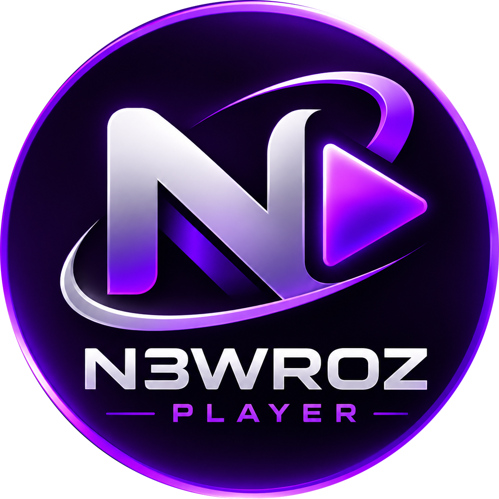

  

  <h1>N3WROZ PLAYER</h2>
  <h3>YOUR CONTENT. YOUR EXPERIENCE.</h3>

**A modern, lightweight and user-friendly IPTV player.**

---

### About

N3WROZ PLAYER is a lightweight IPTV media player designed to deliver a smooth, simple and convenient viewing experience.

Enjoy the freedom to use your own playlists, organize your favorite channels and customize your viewing experience.

### Features

- **M3U URL Support** – Add your own IPTV playlist links.
- **Local File Support** – Import M3U files directly from your device.
- **Channel Search** – Find your channels quickly and easily.
- **Favorites** – Keep your favorite channels organized.
- **Fullscreen Playback** – Enjoy an immersive viewing experience.
- **Portrait & Landscape** – Choose your preferred screen orientation.
- **Brightness Control** – Adjust screen brightness.
- **Multilingual Interface** – Available in English and Turkish.
- **Lightweight & Fast** – Designed for quick startup and smooth navigation.

### Screenshots

Application screenshots will be added soon.

### Platform Compatibility

- Android Smartphones
- Android Tablets
- Android TV Box (planned optimization)
- Android TV / Google TV (planned optimization)

### Download

The latest application releases will be available in the **Releases** section.

### Open Source Project

N3WROZ PLAYER is being developed as an open-source project.

Source code and licensing information will be published as the project progresses.

## Disclaimer

N3WROZ PLAYER is a media player application. It does not host, provide or distribute IPTV channels or streaming content.

Users are responsible for the playlists and media sources they add and for ensuring they have the necessary rights to access them.

---

**N3WROZ PLAYER**

*Simple. Lightweight. Yours.*

Copyright © 2026

---

# N3WROZ PLAYER – Türkçe

### Hakkında

N3WROZ PLAYER, akıcı, kolay ve kullanışlı bir izleme deneyimi sunmak amacıyla geliştirilen hafif bir IPTV medya oynatıcısıdır.

Kendi IPTV listelerinizi ekleyebilir, favori kanallarınızı düzenleyebilir ve izleme deneyiminizi kişiselleştirebilirsiniz.

### Özellikler

- **M3U Bağlantı Desteği:** Kendi IPTV bağlantılarınızı ekleyin.
- **Dosya Desteği:** Cihazınızdan M3U dosyalarını içe aktarın.
- **Kanal Arama:** İstediğiniz kanala kolayca ulaşın.
- **Favoriler:** Sevdiğiniz kanalları kaydedin.
- **Tam Ekran:** Kesintisiz ve geniş ekran izleme deneyimi.
- **Yatay ve Dikey Kullanım:** Tercih ettiğiniz ekran yönünü seçin.
- **Parlaklık Kontrolü:** Ekran parlaklığını ayarlayın.
- **Çoklu Dil:** Türkçe ve İngilizce arayüz.
- **Hafif ve Hızlı:** Hızlı açılış ve akıcı kullanım için tasarlandı.

### Platform Desteği

- Android telefonlar
- Android tabletler
- Android TV Box (uyumluluk çalışmaları planlanıyor)
- Android TV / Google TV (uyumluluk çalışmaları planlanıyor)

### İndirme

Uygulamanın güncel sürümleri GitHub Releases bölümünde yayımlanacaktır.

### Açık Kaynak Projesi

N3WROZ PLAYER açık kaynaklı bir proje olarak geliştirilmektedir. Kaynak kodu ve lisans bilgileri proje ilerledikçe yayımlanacaktır.

## Yasal Bilgilendirme

N3WROZ PLAYER yalnızca bir medya oynatıcı uygulamasıdır. Herhangi bir IPTV kanalı veya yayın içeriği barındırmaz, sağlamaz ya da dağıtmaz.

Kullanıcılar ekledikleri listelerden ve yayın kaynaklarından kendileri sorumludur.

---

**N3WROZ PLAYER**

*Basit. Hafif. Sizin tercihiniz.*

